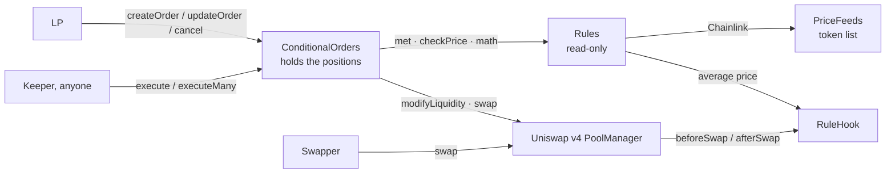

# Alucard

**Your strategy, running on your Uniswap v4 position.**

An LP adds liquidity and, with it, a strategy of their own: conditions ("WETH leaves my range", "falls 5% from its high",
"fees earn less than 5% a year", a timer, a Chainlink price…) and steps ("move everything into another pool and come back
when the price is back", "withdraw 25% every 5% up", "swap to USDC", "re-range next to the price", "compound"). Any keeper
can run a step once its condition is true on-chain and is paid its gas from the position, never more than the owner's cap.
The money stays inside Uniswap v4 (in the position, in the pool it was moved to, or as tokens held in the PoolManager)
until the owner withdraws.

Alucard is not a strategy and does not pick one. It gives LPs the parts to build their own, checks that what they build is
valid, lets them replay it on real history, and runs it exactly as written.

Built for the Uniswap Hook Incubator (UHI11) hookathon, theme "Active management". Live on Ethereum Sepolia.

## What you can build

| | Options |
|---|---|
| **When** | leaves my range (± a margin) · reaches a price · turns x% from its best price (trailing) · a price in another pool · Chainlink price · on a timer · fees earned reach x% · fee rate below x% a year · two of them with and / or · only if it lasts (average over up to an hour) |
| **Then** | move the money to another pool · withdraw some or all · swap to one token · follow the price (re-range next to it) · compound · send fees out · repeat (with a run limit; price levels step) |
| **Move** | into **any Alucard pool that shares a token** with yours (swapped into the shared token on the way, added in a range around that pool's price), or hold one token |
| **Come back when** | back in my range (optionally a margin inside it) · turns x% from its low or high · after a time · at a price; into the same range or a new one around the price |
| **Limits** | slippage, keeper pay cap, expiry, run counts, all checked by the contract on every run |

Each position has two sides ("if WETH falls", "if WETH rises"). The editor builds them as two columns of cards; after each
card it offers only the options that make sense there, and greys out the rest with the reason.

## How it works



| Contract | Size | What it does |
|---|---|---|
| `RuleHook` | 18.9 KB | The v4 hook. `beforeSwap` adds the price that held since the last update to a running sum (tick × seconds) before the first swap of a block, with a snapshot about once a minute: every pool has a manipulation-resistant **average price**. `afterSwap` fills limit orders the swap crossed (at most 3 per swap). |
| `ConditionalOrders` | 23.9 KB | Holds positions that have a strategy (owner = this contract, salt = order id) and the tokens of a move. Runs steps when `Rules` says their condition is true. |
| `Rules` | 19.8 KB | Read-only: is a condition true (`met`), is a strategy valid (`checkSide`, `checkLegs`), is the price believable (`checkPrice`), swap limits, ranges, keeper pay. |
| `PriceFeeds` | 6.7 KB | The token list: a Chainlink feed per token (changes wait 2 days), minimum order size, allowed distance from Chainlink. |

**Why a hook.** Conditions must not be firable by a swap. The hook writes each pool's price into a running sum before the
first swap of every block, so a price pushed inside a block counts for zero seconds, and every condition reads an average
of at least two minutes (ten by default in the editor). It also fills limit orders inside swaps. Strategy steps
themselves run in keeper transactions, never inside someone else's swap.

**A move, step by step** (a falling side set to "move into USDT/USDC, come back when WETH is back in my range"):

1. WETH's average price leaves the range below. A keeper calls `execute`.
2. `Rules.met` confirms it on the average; `Rules.checkPrice` confirms the price of the moment is near the average (not
   pushed).
3. The vault removes the position, swaps the WETH to USDC (stopping at the slippage limit), checks the USDT/USDC pool's
   price the same way, swaps part to USDT and adds a ±0.2% range there. The order now lives in that pool; its "come
   back" sides are live.
4. When WETH's average is back in the original range, a keeper runs the way back: out of USDT/USDC, into USDC, swapped to
   the range's mix, added to the original range. The original sides start again.

## Safety model

- **No step at a pushed price.** Conditions read averages; before any step (and before entering another pool) the price
  of the moment must be within the order's slippage of the average. With `PriceFeeds.maxDeviationTicks` set, the average
  must also be near Chainlink, which stops a price held off for several minutes on a thin pool.
- **Keepers can't overcharge.** Pay = measured gas × capped gas price × a premium, in the position's tokens at Chainlink
  prices, never above the owner's cap. A token without a price pays nothing (the other one pays); with no price at all
  the keeper is not paid, rather than taking the cap.
- **Always withdrawable.** The owner can cancel at any time, wherever the money is; after expiry anyone can, and the
  tokens still go to the owner. Payouts that fail (a wallet refusing ETH) are held for the owner.
- **Admin.** The only admin is the token list. Changing or removing a feed waits two days.

**Known limits.** Not audited. Strategies run on pools of this hook: new pools start thin, which is why the Chainlink
band exists. A move can go into any pool sharing a token with yours; two pools with no token in common would need two
swaps and are not supported yet. Keeper pay caps the priority fee at 1 gwei, which suits L2s (Unichain) and quiet L1
hours. A position must be created through Alucard; existing NFT positions can't be adopted yet.

## Evidence

| Check | Result |
|---|---|
| `forge test` (fuzz included) | 150 passing |
| Branch coverage of `src/` (`forge coverage --ir-minimum`) | 81% (lines 97.6%, functions 99%) |
| Strategy shapes the editor builds vs what the contract accepts (`test/EditorParity.t.sol`) | 39,146 cases, 0 mismatches |
| Backtest engine vs contract, run for run | 2,000 random orders, identical |
| Every template on every pool, dry-run against Sepolia (`frontend/scripts/check-rules.ts`) | all accepted |
| Live trial and keeper batch on Sepolia | [`deployments/README.md`](deployments/README.md) |

Tests are written from what an LP should be able to expect (`test/Safety.t.sol`, `Feeds.t.sol`, `LimitSafety.t.sol`,
`Manipulation.t.sol`, `Strategies.t.sol`…): owners kept apart in the same range, money back on cancel for any range and
size, no run at a pushed price, a young position not mistaken for a dead one, no move into a pushed pool, value kept
through a move but for the swap fee.

## Deployed (Ethereum Sepolia)

| Contract | Address |
|---|---|
| RuleHook | [`0xFf726A970AEab8ceCF068D86bC5Ccf0F0cb6D0C0`](https://sepolia.etherscan.io/address/0xFf726A970AEab8ceCF068D86bC5Ccf0F0cb6D0C0) |
| ConditionalOrders | [`0xfCde70E4Ec35C79CD025306ff26AE1dEfFe72408`](https://sepolia.etherscan.io/address/0xfCde70E4Ec35C79CD025306ff26AE1dEfFe72408) |
| Rules | [`0x94202D49E60c2555Cf2302fF5B33F1674aB1Dcb9`](https://sepolia.etherscan.io/address/0x94202D49E60c2555Cf2302fF5B33F1674aB1Dcb9) |
| PriceFeeds | [`0x179D03b7fd4F2029c7D2427CFfe84abE15e54a7D`](https://sepolia.etherscan.io/address/0x179D03b7fd4F2029c7D2427CFfe84abE15e54a7D) |

Pools, test tokens and the faucet: [`deployments/README.md`](deployments/README.md).

## Run it

```bash
forge install
forge test                      # EditorParity also needs: cd frontend && npm install

cd frontend
npm install && npm run setup:api
npm run dev:api                 # backtest API on 127.0.0.1:8787
npm run dev                     # app on http://localhost:3000
```

Deploying (Vercel, the keeper on GitHub Actions, contracts): [`DEPLOY.md`](DEPLOY.md). The app's own docs are at `/docs`.

## Repository

```
src/                 RuleHook, ConditionalOrders, Rules, PriceFeeds, libraries/ (OrderState packing, PriceMath)
test/                Foundry tests; utils/RuleSetup.sol sets up a pool with price history
script/sepolia/      01 tokens · 02 core · 03 pools · 04 trial · 05 faucet · rehearse-fork.sh
frontend/            Next.js app (editor: components/StrategyEditor.tsx, model: lib/rules.ts)
frontend/api/        backtest engine (Python, numpy) and its data
frontend/scripts/    keeper, check-rules, e2e on a fork, parity helpers, sync
deployments/         addresses written by the deploy scripts
```
