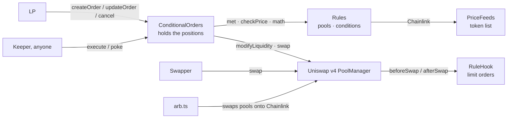

# Alucard

**Your strategy, running on your Uniswap v4 position.**

An LP adds liquidity and, with it, a strategy of their own: conditions ("WETH leaves my range", "falls 5% from its high",
"fees earn less than 5% a year", a timer…) and steps ("move everything into another pool and come back
when the price is back", "withdraw 25% every 5% up", "swap to USDC", "re-range next to the price", "compound"). Any keeper
can run a step once its condition is true on-chain and is paid the owner's keeper fee, out of what the step moves.
The money stays inside Uniswap v4 (in the position, in the pool it was moved to, or as tokens held in the PoolManager)
until the owner withdraws.

Alucard is not a strategy and does not pick one. It gives LPs the parts to build their own, checks that what they build is
valid, lets them replay it on real history, and runs it exactly as written.

Built for the Uniswap Hook Incubator (UHI11) hookathon, theme "Active management". Live on Ethereum Sepolia and Unichain Sepolia.

## What you can build

| | Options |
|---|---|
| **When** | leaves my range (± a margin) · reaches a price · turns x% from its best price (trailing) · a price in another pool · on a timer · fees earned reach x% · fee rate below x% a year · two of them with and / or · only if it lasts (true for N minutes in a row, up to a day) |
| **Then** | move the money to another pool · withdraw some or all · swap to one token · follow the price (re-centre the range around it) · compound · send fees out · repeat (with a run limit; price levels step) |
| **Where** | **any Uniswap v4 pool of two listed tokens**, with our hook or without one |
| **Move** | into **any pool that shares a token** with yours (swapped into the shared token on the way, added in a range around that pool's price), or hold one token |
| **Come back when** | back in my range (optionally a margin inside it) · turns x% from its low or high · after a time · at a price; into the same range or a new one around the price |
| **Limits** | slippage, keeper fee, expiry, run counts, all checked by the contract on every run |

**Say it instead.** The editor has an assistant: type or say "if ETH drops out of my range, park it in USDT/USDC and
come back when it's back in range" and it fills in the cards (Gemini, server-side). It only produces the editor's own
types, every answer goes through the same validation as a hand-built strategy (and is retried once with the refusal),
and it never signs: you read the cards and the plain-words summary, replay it, then save.

**Replay it on real history.** A testnet pool has no traders, so the backtest replays every swap of the Ethereum
mainnet Uniswap v3 pool with the same two tokens (ETH/USDC 0.05% and 0.30%, WBTC/USDC, WBTC/WETH, USDC/USDT, DAI/USDC,
LINK/WETH; 5 April – 3 October 2026), running the exact order words the contract would get.

Each position has two sides ("if WETH falls", "if WETH rises"). The editor builds them as two columns of cards; after each
card it offers only the options that make sense there, and greys out the rest with the reason.

## How it works



| Contract | Size | What it does |
|---|---|---|
| `ConditionalOrders` | 21.3 KB | Holds positions that have a strategy (owner = this contract, salt = order id) and the tokens of a move. Runs a step when `Rules` says its condition is true and the price is near Chainlink; pays the caller the owner's keeper fee. |
| `Rules` | 17.8 KB | The pool table (any v4 pool of two listed tokens, hookless or ours) and the logic: is a condition true (`met`), is the price believable (`checkPrice`), is a strategy valid (`checkSide`, `checkLegs`), swap limits, ranges. |
| `RuleHook` | 16.4 KB | The v4 hook: limit orders filled inside the swap that crosses them (at most 3 per swap; a 0.1% reward for filling the rest). |
| `PriceFeeds` | 5.8 KB | The token list: a Chainlink feed per token (changes wait 2 days), and how far a pool may be from Chainlink (200 ticks, ~2%). |

**Why prices can be trusted.** A pool's price counts only while it is within ~2% of the pair's Chainlink price. Pushing a
pool to fire someone's strategy means pushing it away from Chainlink, and then the push does not count, however long it is
held; before any step (and before entering another pool) the price is checked again. In a real move Chainlink moves too,
and the step runs at once. No price history is stored, so swaps pay nothing for strategies, and strategies work on deep
existing pools. On a testnet nobody arbitrages the pools, so `frontend/scripts/arb.ts` does: it keeps every pool on
Chainlink (run it on your machine, `--keep` also runs the keeper).

**Why a hook.** Limit orders are filled inside the swap that crosses them, at the exact price, with no keeper. Strategies
need decisions a swap cannot take (moving money between pools, waiting, coming back), so keepers run them.

**A move, step by step** (a falling side set to "move into USDT/USDC, come back when WETH is back in my range"):

1. WETH's price leaves the range below (Chainlink agrees). A keeper calls `execute`.
2. `Rules.met` confirms it (a price near Chainlink's); `Rules.checkPrice` confirms the pool is still near Chainlink.
3. The vault removes the position, swaps the WETH to USDC (stopping at the slippage limit), checks the USDT/USDC pool's
   price the same way, swaps part to USDT and adds a ±0.2% range there. The order now lives in that pool; its "come
   back" sides are live.
4. When WETH is back in the original range, a keeper runs the way back: out of USDT/USDC, into USDC, swapped to
   the range's mix, added to the original range. The original sides start again.

## Safety model: what you are trusting

| You trust | What it can do | What it cannot do |
|---|---|---|
| **Chainlink** | Decide what a price is: a pool's price counts only within ~2% (200 ticks) of the pair's Chainlink price. A stale or missing feed makes every step wait. | Fire a step on its own: the pool's price must also be past your level. Lock your money: `cancel` never checks prices. |
| **Keepers** (anyone) | Run a step once its condition is true, and pick the moment within the band. | Take more than your keeper fee (0.1% default, at most 1% of what the step moves) as a fee. Run a step early, skip a hold, or run it at a pushed price. |
| **The admin** (the token list) | List a token (at once: no order uses it yet); change or remove a feed, or loosen / switch off the band, **2 days after announcing it**; tighten the band at once (that only makes steps wait). | Move, freeze or upgrade anything: there is no pause, no upgrade, no fee switch. |
| **The testnet** | On Sepolia nobody arbitrages, so `arb.ts` keeps the pools on Chainlink; the USDT "feed" is a mock we set to $1. | |

Guarantees, each with a test:

- **No step at a pushed price.** A push away from Chainlink does not count, however long it is held (`Manipulation.t.sol`).
- **Holds can't be skipped, or reset by a push.** "Only if it lasts" needs the condition seen true by `poke` and still
  true at the run; a believable price that says otherwise resets it, a pushed one does nothing. A hold is sampled by
  pokes, not watched every block.
- **Your money is yours.** The owner can cancel at any time, wherever the money is; after expiry anyone can close the
  position, and everything still goes to the owner. Payouts that fail (a wallet refusing ETH) are held for the owner,
  and nobody else's order can spend them (`KeeperFee.t.sol`).

**Known limits** (from our own review; not yet fixed): inside the band, a keeper can push the price up to ~2% against
an order's swap before running it, on top of the order's slippage limit, and near a range edge it could push a position
out and back in to collect the fee twice; set price levels and "back in my range" margins wider than the band. One band
for every pair (too wide for two stablecoins). Not audited. Only tokens with a Chainlink feed. A move into a pool with
no token in common is not supported. A position must be created through Alucard; existing NFT positions can't be
adopted yet.

## Evidence

| Check | Result |
|---|---|
| `forge test` (fuzz included) | 137 passing |
| Branch coverage of `src/` (`forge coverage --ir-minimum`) | 84% (lines 97%, functions 98%) |
| Strategy shapes the editor builds vs what the contract accepts (`test/EditorParity.t.sol`) | 35,126 cases, 0 mismatches |
| Backtest engine vs contract, run for run (holds and re-centring included) | 2,000 random orders, identical |
| Every template on every pool, dry-run against Sepolia (`frontend/scripts/check-rules.ts`) | 168 / 168 accepted |
| End to end on a local fork (`script/sepolia/rehearse-fork.sh`): the market moves, `arb.ts` follows, the keeper runs | all checks pass |

Tests are written from what an LP should be able to expect (`test/Safety.t.sol`, `Feeds.t.sol`, `LimitSafety.t.sol`,
`Manipulation.t.sol`, `Strategies.t.sol`, `KeeperFee.t.sol`…): owners kept apart in the same range, money back on cancel
for any range and size, a push held for hours fires nothing while a real move fires at once, holds that cannot be
skipped, no move into a pushed pool, value kept through a move but for the swap fee and the keeper's fee, strategies on
a hookless pool.

## Deployed (Ethereum Sepolia and Unichain Sepolia)

The same contracts on both testnets, each with its own test tokens and eight pools. The app's network menu switches
between them (and follows your wallet).

| Contract | Ethereum Sepolia (11155111) | Unichain Sepolia (1301) |
|---|---|---|
| RuleHook | [`0x0482…50C0`](https://sepolia.etherscan.io/address/0x0482555fd63636Baa88bF1eA7d0e48e3F2Cb50C0) | [`0x8B7f…90C0`](https://sepolia.uniscan.xyz/address/0x8B7f7798eE5d9Af14529eB964A1e912b670890C0) |
| ConditionalOrders | [`0xa653…Db3c`](https://sepolia.etherscan.io/address/0xa653D69C934B431431C11e55a59bbf69e524Db3c) | [`0xb190…3FBD`](https://sepolia.uniscan.xyz/address/0xb190f93B9511B40c12F068b9bdd2d392aBAC3FBD) |
| Rules | [`0x59AC…996E`](https://sepolia.etherscan.io/address/0x59AC15D97080BF47be608750d82bB9528e57996E) | [`0x67CB…a947`](https://sepolia.uniscan.xyz/address/0x67CB05bb62b72DCbd359670acEb53E0159bda947) |
| PriceFeeds | [`0xC539…2a1b`](https://sepolia.etherscan.io/address/0xC539EE58250B88F2ECAb86682c06ce4cD6592a1b) | [`0xA7dD…6C36`](https://sepolia.uniscan.xyz/address/0xA7dD5FCE507A4b6F0a24aBdCB169DaA023746C36) |

On Unichain Sepolia every token but DAI has a real Chainlink feed (USDT too, which Sepolia lacks); DAI uses a fixed $1
mock there. Full addresses, tokens, pools and faucets: [`deployments/README.md`](deployments/README.md).

## Run it

```bash
forge install
forge test                      # EditorParity also needs: cd frontend && npm install

cd frontend
npm install && npm run setup:api
npm run dev:api                 # backtest API on 127.0.0.1:8787
npm run dev                     # app on http://localhost:3000

PRIVATE_KEY=0x... npx tsx scripts/arb.ts --keep     # keep the test pools on Chainlink, and run the keeper, every minute
CHAIN=unichain PRIVATE_KEY=0x... npx tsx scripts/arb.ts --keep   # the same on Unichain Sepolia (RPC: your Sepolia Alchemy key, swapped)
PRIVATE_KEY=0x... npx tsx scripts/demo-orders.ts    # a few example strategies in tight ranges
# the assistant: GEMINI_API_KEYS=key1,key2 in frontend/.env.local (server-side only; a rate-limited key is skipped)
```

Deploying (Vercel, the keeper on GitHub Actions, contracts): [`DEPLOY.md`](DEPLOY.md). The app's own docs are at `/docs`.

## Repository

```
src/                 RuleHook, ConditionalOrders, Rules, PriceFeeds, libraries/ (OrderState packing, PriceMath)
test/                Foundry tests; utils/RuleSetup.sol sets up a pool, feeds and two LPs
script/sepolia/      01 tokens · 02 core · 03 pools · 04 trial · 05 faucet · ForkMarket (mock feeds, fork only) · rehearse-fork.sh
frontend/            Next.js app (editor: components/StrategyEditor.tsx, model: lib/rules.ts)
frontend/api/        backtest engine (Python, numpy) and its data
frontend/scripts/    arb (arbitrage bot), keeper, demo-orders, check-rules, e2e on a fork, parity helpers, sync
deployments/         addresses written by the deploy scripts
```
