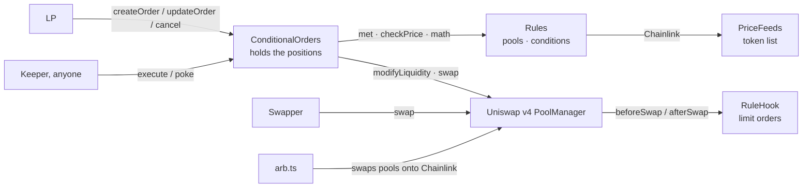

# Alucard

**Your strategy, running on your Uniswap v4 position.**

An LP adds liquidity and, with it, a strategy of their own: conditions ("WETH leaves my range", "falls 5% from its high",
"fees earn less than 5% a year", a timer…) and steps ("move everything into another pool and come back
when the price is back", "withdraw 25% every 5% up", "swap to USDC", "re-range next to the price", "compound"). Any keeper
can run a step once its condition is true on-chain and is paid the owner's keeper fee, out of what the step moves.
The money stays inside Uniswap v4 (in the position, in the pool it was moved to, or as tokens held in the PoolManager)
until the owner withdraws.

Alucard is not a strategy and does not pick one. It gives LPs the parts to build their own, checks that what they build is
valid, lets them replay it on real history, and runs it exactly as written.

Built for the Uniswap Hook Incubator (UHI11) hookathon, theme "Active management". Live on Ethereum Sepolia.

## What you can build

| | Options |
|---|---|
| **When** | leaves my range (± a margin) · reaches a price · turns x% from its best price (trailing) · a price in another pool · on a timer · fees earned reach x% · fee rate below x% a year · two of them with and / or · only if it lasts (true for N minutes in a row, up to a day) |
| **Then** | move the money to another pool · withdraw some or all · swap to one token · follow the price (re-centre the range around it) · compound · send fees out · repeat (with a run limit; price levels step) |
| **Where** | **any Uniswap v4 pool of two listed tokens**, with our hook or without one |
| **Move** | into **any pool that shares a token** with yours (swapped into the shared token on the way, added in a range around that pool's price), or hold one token |
| **Come back when** | back in my range (optionally a margin inside it) · turns x% from its low or high · after a time · at a price; into the same range or a new one around the price |
| **Limits** | slippage, keeper fee, expiry, run counts, all checked by the contract on every run |

Each position has two sides ("if WETH falls", "if WETH rises"). The editor builds them as two columns of cards; after each
card it offers only the options that make sense there, and greys out the rest with the reason.

## How it works



| Contract | Size | What it does |
|---|---|---|
| `ConditionalOrders` | 21.3 KB | Holds positions that have a strategy (owner = this contract, salt = order id) and the tokens of a move. Runs a step when `Rules` says its condition is true and the price is near Chainlink; pays the caller the owner's keeper fee. |
| `Rules` | 17.8 KB | The pool table (any v4 pool of two listed tokens, hookless or ours) and the logic: is a condition true (`met`), is the price believable (`checkPrice`), is a strategy valid (`checkSide`, `checkLegs`), swap limits, ranges. |
| `RuleHook` | 16.4 KB | The v4 hook: limit orders filled inside the swap that crosses them (at most 3 per swap; a 0.1% reward for filling the rest). |
| `PriceFeeds` | 5.8 KB | The token list: a Chainlink feed per token (changes wait 2 days), and how far a pool may be from Chainlink (200 ticks, ~2%). |

**Why prices can be trusted.** A pool's price counts only while it is within ~2% of the pair's Chainlink price. Pushing a
pool to fire someone's strategy means pushing it away from Chainlink, and then the push does not count, however long it is
held; before any step (and before entering another pool) the price is checked again. In a real move Chainlink moves too,
and the step runs at once. No price history is stored, so swaps pay nothing for strategies, and strategies work on deep
existing pools. On a testnet nobody arbitrages the pools, so `frontend/scripts/arb.ts` does: it keeps every pool on
Chainlink (run it on your machine, `--keep` also runs the keeper).

**Why a hook.** Limit orders are filled inside the swap that crosses them, at the exact price, with no keeper. Strategies
need decisions a swap cannot take (moving money between pools, waiting, coming back), so keepers run them.

**A move, step by step** (a falling side set to "move into USDT/USDC, come back when WETH is back in my range"):

1. WETH's price leaves the range below (Chainlink agrees). A keeper calls `execute`.
2. `Rules.met` confirms it (a price near Chainlink's); `Rules.checkPrice` confirms the pool is still near Chainlink.
3. The vault removes the position, swaps the WETH to USDC (stopping at the slippage limit), checks the USDT/USDC pool's
   price the same way, swaps part to USDT and adds a ±0.2% range there. The order now lives in that pool; its "come
   back" sides are live.
4. When WETH is back in the original range, a keeper runs the way back: out of USDT/USDC, into USDC, swapped to
   the range's mix, added to the original range. The original sides start again.

## Safety model

- **No step at a pushed price.** A price counts only near Chainlink's; with no Chainlink price, nothing runs.
- **Holds can't be skipped.** "Only if it lasts" needs the condition true from the moment a keeper first saw it (`poke`)
  for the whole time; a keeper that sees it false resets it.
- **Keepers can't overcharge.** The fee is the owner's: a share of what the step moves (0.1% by default, at most 1%),
  whatever the gas price.
- **Always withdrawable.** The owner can cancel at any time, wherever the money is; after expiry anyone can, and the
  tokens still go to the owner. Payouts that fail (a wallet refusing ETH) are held for the owner.
- **Admin.** The only admin is the token list. Changing or removing a feed waits two days.

**Known limits.** Not audited. Only tokens with a Chainlink feed. A push inside the ~2% band is a real price for a
condition (set levels further than that from the market). A move can go into any pool sharing a token with yours; two
pools with no token in common would need two swaps and are not supported yet. A position must be created through
Alucard; existing NFT positions can't be adopted yet.

## Evidence

| Check | Result |
|---|---|
| `forge test` (fuzz included) | 134 passing |
| Branch coverage of `src/` (`forge coverage --ir-minimum`) | 84% (lines 97%, functions 98%) |
| Strategy shapes the editor builds vs what the contract accepts (`test/EditorParity.t.sol`) | 35,126 cases, 0 mismatches |
| Backtest engine vs contract, run for run (holds and re-centring included) | 2,000 random orders, identical |
| Every template on every pool, dry-run against Sepolia (`frontend/scripts/check-rules.ts`) | 168 / 168 accepted |
| End to end on a local fork (`script/sepolia/rehearse-fork.sh`): the market moves, `arb.ts` follows, the keeper runs | all checks pass |

Tests are written from what an LP should be able to expect (`test/Safety.t.sol`, `Feeds.t.sol`, `LimitSafety.t.sol`,
`Manipulation.t.sol`, `Strategies.t.sol`, `KeeperFee.t.sol`…): owners kept apart in the same range, money back on cancel
for any range and size, a push held for hours fires nothing while a real move fires at once, holds that cannot be
skipped, no move into a pushed pool, value kept through a move but for the swap fee and the keeper's fee, strategies on
a hookless pool.

## Deployed (Ethereum Sepolia)

| Contract | Address |
|---|---|
| RuleHook | [`0x5F8Bfff761fE01aE2586a19036dfdC0C1220D0C0`](https://sepolia.etherscan.io/address/0x5F8Bfff761fE01aE2586a19036dfdC0C1220D0C0) |
| ConditionalOrders | [`0x6CD66E4c91635E2C7705fa2CE61Ac6df24cb12d3`](https://sepolia.etherscan.io/address/0x6CD66E4c91635E2C7705fa2CE61Ac6df24cb12d3) |
| Rules | [`0xc2c6CC90005823829c2Cf0415D9cD30dae8705D3`](https://sepolia.etherscan.io/address/0xc2c6CC90005823829c2Cf0415D9cD30dae8705D3) |
| PriceFeeds | [`0x6Ea9DCEF1EA55001E2a87FafA0F6b7D0cCe45DF6`](https://sepolia.etherscan.io/address/0x6Ea9DCEF1EA55001E2a87FafA0F6b7D0cCe45DF6) |

Pools, test tokens and the faucet: [`deployments/README.md`](deployments/README.md).

## Run it

```bash
forge install
forge test                      # EditorParity also needs: cd frontend && npm install

cd frontend
npm install && npm run setup:api
npm run dev:api                 # backtest API on 127.0.0.1:8787
npm run dev                     # app on http://localhost:3000

PRIVATE_KEY=0x... npx tsx scripts/arb.ts --keep     # keep the test pools on Chainlink, and run the keeper, every minute
PRIVATE_KEY=0x... npx tsx scripts/demo-orders.ts    # a few example strategies in tight ranges
```

Deploying (Vercel, the keeper on GitHub Actions, contracts): [`DEPLOY.md`](DEPLOY.md). The app's own docs are at `/docs`.

## Repository

```
src/                 RuleHook, ConditionalOrders, Rules, PriceFeeds, libraries/ (OrderState packing, PriceMath)
test/                Foundry tests; utils/RuleSetup.sol sets up a pool, feeds and two LPs
script/sepolia/      01 tokens · 02 core · 03 pools · 04 trial · 05 faucet · ForkMarket (mock feeds, fork only) · rehearse-fork.sh
frontend/            Next.js app (editor: components/StrategyEditor.tsx, model: lib/rules.ts)
frontend/api/        backtest engine (Python, numpy) and its data
frontend/scripts/    arb (arbitrage bot), keeper, demo-orders, check-rules, e2e on a fork, parity helpers, sync
deployments/         addresses written by the deploy scripts
```
