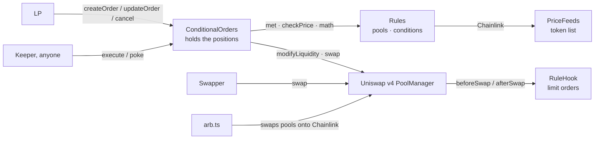

# Alucard

**Your own strategy for a Uniswap v4 position, written once, replayed on real history, run on-chain by anyone.**

You sleep. It keeps watch. An LP describes what should happen to their liquidity ("if ETH falls out of my range, move it
into USDT/USDC and bring it back when ETH is back"; "take 25% profit every 5% up"; "re-range whenever it leaves"),
replays it on every real mainnet swap of the same pair, and saves it. From then on any keeper can run each step the
moment its condition is true, for a fee the owner set. The money never leaves Uniswap v4 until the owner withdraws.

Built for the Uniswap Hook Incubator (UHI11), theme "Active management". **Live on Ethereum Sepolia and Unichain
Sepolia.** Alucard does not pick strategies or promise returns: it gives LPs the parts, checks what they build, shows how
it would have done, and runs it exactly as written.

## In 60 seconds

| | |
|---|---|
| **The problem** | Concentrated liquidity earns only in range. Out of range it earns nothing and sits in the falling token, and nothing changes unless the LP watches the price and acts, day and night. |
| **What Alucard adds** | A **strategy attached to the position**: two sides ("if ETH falls", "if ETH rises"), each a short chain of steps. Steps include **moving the whole position into another pool and coming back by the LP's own rule**: a round trip between Uniswap pools that existing tools do not offer. |
| **How you build it** | A flow of small step cards (When → Then → Come back when → Back into), or **say it to the assistant** (Gemini): it asks back when something is missing, then fills in the same cards. It cannot build anything the contract would refuse, and it never signs. |
| **Why you can trust it** | A pool's price counts only within ~2% of Chainlink's, so **nobody can push a pool to fire your strategy**. The owner can always cancel and withdraw. Keepers earn only the fee the owner set. One admin power (the token list), behind a 2-day delay. Known limit: inside the ~2% band a keeper can still move the price against a step's swap, on top of its slippage limit ([details](#safety-model-what-you-are-trusting)). |
| **Proof it does what it says** | The backtest engine runs the **same order words** as the contract; on 2,000 random orders its steps fire at exactly the same swaps as the contract's. 138 contract tests, 35,126 editor-vs-contract cases, every template dry-run against both live deployments. |

## What you can build

| | Options |
|---|---|
| **When** | leaves my range (± a margin) · reaches a price · turns x% from its best price (trailing) · a price in another pool · on a timer · fees earned reach x% · fee rate below x% a year · two of them with and / or · only if it lasts (true for N minutes in a row, up to a day) |
| **Then** | move the money to another pool · withdraw some or all · swap to one token · re-range around the price · compound · send fees out · repeat (with a run limit; price levels step) |
| **Where** | **any Uniswap v4 pool of two listed tokens**, with our hook or without one |
| **Move into** | **any pool that shares a token** with yours (swapped into the shared token on the way, added in a range around that pool's price), or hold one token |
| **Come back when** | back in my range (optionally a margin inside it) · turns x% from its low or high · after a time · at a price; into the same range or a new one around the price |
| **Limits** | slippage, keeper fee, expiry, run counts, all checked by the contract on every run |

The builder shows the strategy as a flow: the position at the top, branching into the two sides, each step a one-line
card. A step's settings open only when you click it; "Add" offers only the options that fit after the steps above it.
Re-ranging moves the range itself, so a side that watches "leaves my range" follows the new range (tested on the contract
and the engine). Combinations that would loop (a repeating fixed price on a re-ranging side) are refused by the contract.

**Replay it on real history.** A testnet pool has no traders, so the backtest replays every swap of the Ethereum
mainnet Uniswap v3 pool with the same two tokens (ETH/USDC 0.05% and 0.30%, WBTC/USDC, WBTC/WETH, USDC/USDT, DAI/USDC,
LINK/WETH; 5 April – 3 October 2026; up to a million swaps) and shows the result next to the same position without the
strategy and next to just holding. 180 days of a million swaps replay in about 0.2 s.

## How it works



| Contract | Size | What it does |
|---|---|---|
| `ConditionalOrders` | 21.5 KB | Holds positions that have a strategy (owner = this contract, salt = order id) and the tokens of a move. Runs a step when `Rules` says its condition is true and the price is near Chainlink; pays the caller the owner's keeper fee. |
| `Rules` | 17.8 KB | The pool table (any v4 pool of two listed tokens, hookless or ours) and the logic: is a condition true (`met`), is the price believable (`checkPrice`), is a strategy valid (`checkSide`, `checkLegs`), swap limits, ranges. |
| `RuleHook` | 16.4 KB | The v4 hook: limit orders filled inside the swap that crosses them (at most 3 per swap; a 0.1% reward for filling the rest). |
| `PriceFeeds` | 6.3 KB | The token list: a Chainlink feed per token (changes wait 2 days), and how far a pool may be from Chainlink (200 ticks, ~2%). |

**Why prices can be trusted.** A pool's price counts only while it is within ~2% of the pair's Chainlink price. Pushing a
pool to fire someone's strategy means pushing it away from Chainlink, and then the push does not count, however long it is
held; before any step (and before entering another pool) the price is checked again. In a real move Chainlink moves too,
and the step runs at once. No price history is stored, so swaps pay nothing for strategies, and strategies work on deep
existing pools. On a testnet nobody arbitrages the pools, so `frontend/scripts/arb.ts` does: it keeps every pool on
Chainlink (run it on your machine, `--keep` also runs the keeper).

**Why a hook.** Limit orders are filled inside the swap that crosses them, at the exact price, with no keeper. Strategies
need decisions a swap cannot take (moving money between pools, waiting, coming back), so keepers run them.

**A move, step by step** (a falling side set to "move into USDT/USDC, come back when WETH is back in my range"):

1. WETH's price leaves the range below (Chainlink agrees). A keeper calls `execute`.
2. `Rules.met` confirms it (a price near Chainlink's); `Rules.checkPrice` confirms the pool is still near Chainlink.
3. The vault removes the position, swaps the WETH to USDC (stopping at the slippage limit), checks the USDT/USDC pool's
   price the same way, swaps part to USDT and adds a ±0.2% range there. The order now lives in that pool; its "come
   back" sides are live.
4. When WETH is back in the original range, a keeper runs the way back: out of USDT/USDC, into USDC, swapped to
   the range's mix, added to the original range. The original sides start again.

## Safety model: what you are trusting

| You trust | What it can do | What it cannot do |
|---|---|---|
| **Chainlink** | Decide what a price is: a pool's price counts only within ~2% (200 ticks) of the pair's Chainlink price. A stale or missing feed makes every step wait. | Fire a step on its own: the pool's price must also be past your level. Lock your money: `cancel` never checks prices. |
| **Keepers** (anyone) | Run a step once its condition is true, and pick the moment within the band. | Take more than your keeper fee (0.1% default, at most 1% of what the step moves) as a fee. Run a step early, skip a hold, or run it at a pushed price. |
| **The admin** (the token list) | List a token (at once: no order uses it yet); change or remove a feed, or loosen / switch off the band, **2 days after announcing it**; tighten the band at once (that only makes steps wait). | Move, freeze or upgrade anything: there is no pause, no upgrade, no fee switch. |
| **The testnet** | On Sepolia nobody arbitrages, so `arb.ts` keeps the pools on Chainlink; the USDT "feed" is a mock we set to $1. | |

Guarantees, each with a test:

- **No step at a pushed price.** A push away from Chainlink does not count, however long it is held (`Manipulation.t.sol`).
- **Holds can't be skipped, or reset by a push.** "Only if it lasts" needs the condition seen true by `poke` and still
  true at the run; a believable price that says otherwise resets it, a pushed one does nothing. A hold is sampled by
  pokes, not watched every block.
- **Your money is yours.** The owner can cancel at any time, wherever the money is; after expiry anyone can close the
  position, and everything still goes to the owner. Payouts that fail (a wallet refusing ETH) are held for the owner,
  and nobody else's order can spend them (`KeeperFee.t.sol`).

**Known limits** (from our own review; not yet fixed): inside the band, a keeper can push the price up to ~2% against
an order's swap before running it, on top of the order's slippage limit, and near a range edge it could push a position
out and back in to collect the fee twice; set price levels and "back in my range" margins wider than the band. One band
for every pair (too wide for two stablecoins). Not audited. Only tokens with a Chainlink feed. A move into a pool with
no token in common is not supported. A position must be created through Alucard; existing NFT positions can't be
adopted yet.

## Evidence

| Check | Result |
|---|---|
| `forge test` (fuzz included) | 138 passing |
| Branch coverage of `src/` (`forge coverage --ir-minimum`) | 84% (lines 97%, functions 98%) |
| Strategy shapes the editor builds vs what the contract accepts (`test/EditorParity.t.sol`) | 35,126 cases, 0 mismatches |
| Backtest engine vs contract: when each step fires (holds and re-centring included; outcomes in money are not compared) | 2,000 random orders, same swaps |
| Backtest engine tests (`frontend/api/test_chain_history.py`) | 10 passing |
| Every template on every pool, dry-run against the live deployments (`frontend/scripts/check-rules.ts`) | 168 / 168 on Sepolia and on Unichain Sepolia |
| End to end on the live chains: pools on Chainlink (`arb.ts`), strategies created, a keeper runs a real step | done on both chains |
| End to end on a local fork (`script/sepolia/rehearse-fork.sh`): the market moves, arbitrage follows, the keeper runs | all checks pass |

Tests are written from what an LP should be able to expect (`test/Safety.t.sol`, `Feeds.t.sol`, `LimitSafety.t.sol`,
`Manipulation.t.sol`, `Strategies.t.sol`, `KeeperFee.t.sol`, `Execution.t.sol`): owners kept apart in the same range,
money back on cancel for any range and size, a push held for hours fires nothing while a real move fires at once, holds
that cannot be skipped or reset by a push, nobody can spend ETH held for another owner, no move into a pushed pool, value
kept through a move but for the swap fee and the keeper's fee, strategies on a hookless pool, re-ranging both ways.

## How it compares

From each project's public docs (November 2026); a dash means we found no such feature.

| | Revert | Krystal | Arrakis, Gamma (vaults) | DualPool (Uniswap + Spark) | **Alucard** |
|---|---|---|---|---|---|
| Who decides | the user, from presets | the user, from presets | the vault manager | the pool's hook | **the LP, step by step** |
| Exit, re-range, compound, trailing stop | yes | yes (with a time buffer) | managed | no | yes |
| **Move to another Uniswap pool and come back by your own rule** | — | — | — | idle liquidity into lending, decided by the hook | **yes** |
| Replay on real history before committing | a static range ([backtester](https://docs.revert.finance/revert/technical-docs/backtester)) | — | — | — | **the whole strategy; its steps fire at the same swaps as the contract** |
| Works on existing pools | yes (v3; v4 per secondary sources) | yes | own vaults | pools with the hook | **any v4 pool of listed tokens, hookless too** |
| Push-resistant prices | TWAP check (auto-exit) | — | TWAP / deviation checks | — | **Chainlink band (~2%) on every condition and step** |
| Audited, live on mainnet, TVL | yes | yes | yes | yes | **no: testnets, not audited** |

## For reviewers: where to check each claim

| Claim | Where |
|---|---|
| A pushed price never fires a strategy; a real move does at once | `test/Manipulation.t.sol`, `src/Rules.sol` (`tickOf`, `checkPrice`) |
| Moves into another pool and back | `src/ConditionalOrders.sol` (`_move`), `test/Strategies.t.sol` |
| The backtest runs what the contract runs | `test/EditorParity.t.sol`, `frontend/api/_engine.py`, `frontend/scripts/parity.ts` |
| The editor never builds what the contract refuses | `frontend/lib/rules.ts` (`validate`), `test/EditorParity.t.sol` |
| The assistant cannot exceed the editor | `frontend/lib/assistant.ts` (`coerceRules`), `frontend/app/api/assistant/route.ts` |
| Keepers earn only the owner's fee | `test/KeeperFee.t.sol` |
| What you trust, and the known limits | [Safety model](#safety-model-what-you-are-trusting) below |
| Live addresses on both chains | [`deployments/README.md`](deployments/README.md) |

## Deployed (Ethereum Sepolia and Unichain Sepolia)

The same contracts on both testnets, each with its own test tokens and eight pools. The app's network menu switches
between them (and follows your wallet).

| Contract | Ethereum Sepolia (11155111) | Unichain Sepolia (1301) |
|---|---|---|
| RuleHook | [`0x0482…50C0`](https://sepolia.etherscan.io/address/0x0482555fd63636Baa88bF1eA7d0e48e3F2Cb50C0) | [`0x8B7f…90C0`](https://sepolia.uniscan.xyz/address/0x8B7f7798eE5d9Af14529eB964A1e912b670890C0) |
| ConditionalOrders | [`0xa653…Db3c`](https://sepolia.etherscan.io/address/0xa653D69C934B431431C11e55a59bbf69e524Db3c) | [`0xb190…3FBD`](https://sepolia.uniscan.xyz/address/0xb190f93B9511B40c12F068b9bdd2d392aBAC3FBD) |
| Rules | [`0x59AC…996E`](https://sepolia.etherscan.io/address/0x59AC15D97080BF47be608750d82bB9528e57996E) | [`0x67CB…a947`](https://sepolia.uniscan.xyz/address/0x67CB05bb62b72DCbd359670acEb53E0159bda947) |
| PriceFeeds | [`0xC539…2a1b`](https://sepolia.etherscan.io/address/0xC539EE58250B88F2ECAb86682c06ce4cD6592a1b) | [`0xA7dD…6C36`](https://sepolia.uniscan.xyz/address/0xA7dD5FCE507A4b6F0a24aBdCB169DaA023746C36) |

On Unichain Sepolia every token but DAI has a real Chainlink feed (USDT too, which Sepolia lacks); DAI uses a fixed $1
mock there. Full addresses, tokens, pools and faucets: [`deployments/README.md`](deployments/README.md).

## Run it

```bash
forge install
forge test                      # EditorParity also needs: cd frontend && npm install

cd frontend
npm install && npm run setup:api
npm run dev:api                 # backtest API on 127.0.0.1:8787
npm run dev                     # app on http://localhost:3000

PRIVATE_KEY=0x... npx tsx scripts/arb.ts --keep     # keep the test pools on Chainlink, and run the keeper, every minute
CHAIN=unichain PRIVATE_KEY=0x... npx tsx scripts/arb.ts --keep   # the same on Unichain Sepolia (RPC: your Sepolia Alchemy key, swapped)
PRIVATE_KEY=0x... npx tsx scripts/demo-orders.ts    # a few example strategies in tight ranges
# the assistant: GEMINI_API_KEYS=key1,key2 in frontend/.env.local (server-side only; a rate-limited key is skipped)
```

Deploying (Vercel, the keeper on GitHub Actions, contracts): [`DEPLOY.md`](DEPLOY.md). The app's own docs are at `/docs`.

## Repository

```
src/                 RuleHook, ConditionalOrders, Rules, PriceFeeds, libraries/ (OrderState packing, PriceMath)
test/                Foundry tests; utils/RuleSetup.sol sets up a pool, feeds and two LPs
script/sepolia/      01 tokens · 02 core · 03 pools · 04 trial · 05 faucet (Net.sol: per-chain files and feeds) · ForkMarket · rehearse-fork.sh
frontend/            Next.js app: builder components/StrategyEditor.tsx (model lib/rules.ts), assistant components/Assistant.tsx
                     + app/api/assistant (Gemini), landing components/night, chains lib/chain.ts
frontend/api/        backtest engine (Python, numpy), its tests, and the mainnet swap histories (_data/*.npz)
frontend/scripts/    arb (arbitrage bot), keeper, demo-orders, check-rules, e2e on a fork, parity helpers, sync
deployments/         addresses written by the deploy scripts, both chains
```
